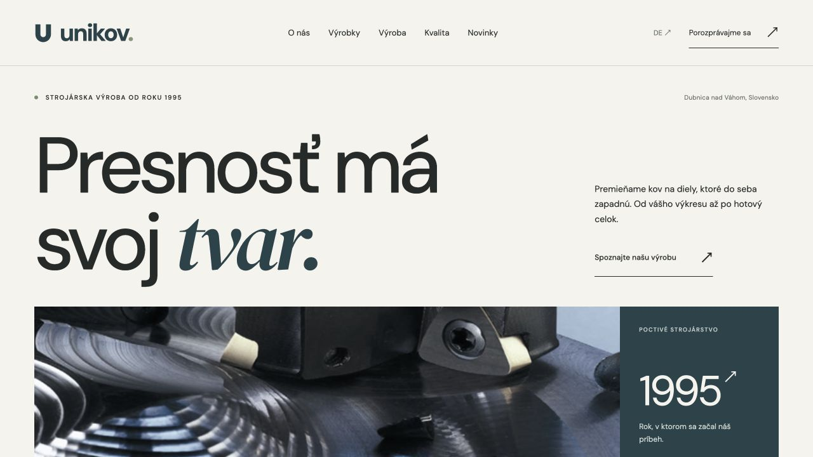

# UNIKOV — nová podoba webu

**[Otvoriť živý web na GitHub Pages](https://matejsmutny1-droid.github.io/unikov-web/)**



Kompletný statický web pripravený podľa obsahu https://www.unikov.sk/ načítaného 16. novembra 2026. Dizajn používa teplú bielu, modrozelenú, výraznú typografiu a jemné delenie obsahu. Fotografie v náhľadoch majú jednotný jemný grading cez CSS; zväčšená galéria ukazuje pôvodné súbory.

## Obsah

- Úvod a firemný profil, rok založenia, tím, odvetvia a spôsob spolupráce.
- Zákazková výroba: všetkých 32 fotografií.
- Vlastné výrobky: zachované zameranie; pôvodná podstránka nemala produktové detaily.
- Výroba: kompletný strojový park, výrobné možnosti s rozmermi, logistika a všetkých 19 fotografií výroby.
- Kvalita: vlastný systém riadenia kvality a všetkých 6 fotografií meracej techniky. Nepridané žiadne nepodložené ISO/DIN certifikácie.
- Kontakt: oba telefóny, e-mail, adresa, IČO, IČ DPH, register, daňový úrad a bankové spojenie.
- Novinky: pôvodná sekcia bola prázdna, nové články nie sú vymyslené.
- Odkaz DE vedie na pôvodnú nemeckú verziu webu.

## Funkcie

Responzívna navigácia, zväčšovanie a listovanie fotografiami (aj šípkami na klávesnici), radenie produktov, priame telefonické a e-mailové odkazy, odkaz na mapu. Dopytový formulár zostaví `mailto:` správu a otvorí e-mailového klienta; serverové odosielanie ani ukladanie osobných údajov neobsahuje.

## Spustenie a úpravy

Bez inštalácie závislostí:

```sh
node --check dist/app.js
node build.mjs
npm start
```

Obsah a interakcie sú v `dist/app.js`, štýly v `dist/style.css`, fotografie v `dist/assets/`. Build predgeneruje obsah všetkých stránok do HTML a overí interné odkazy a súbory. Web je samostatný a neobsahuje väzbu na pôvodný náhľadový hosting. Podrobnosti o nasadení nájdete v `DEPLOYMENT.md`.

## Údaje na potvrdenie firmou

Obsah vychádza z pôvodného webu. Pred použitím ako oficiálny firemný web je potrebné potvrdiť aktuálnosť počtu pracovníkov, strojových kapacít, parametrov, registračných a bankových údajov a stavu certifikácie. Pôvodný web neuvádzal IBAN ani jednotku pri maximálnych rozmeroch zváraných dielov; tieto údaje nie sú domyslené. Pôvodné staršie adresy podstránok zostávajú funkčné. Technické PHP chyby a reklamné pätičky pôvodného CMS neboli prenesené.
